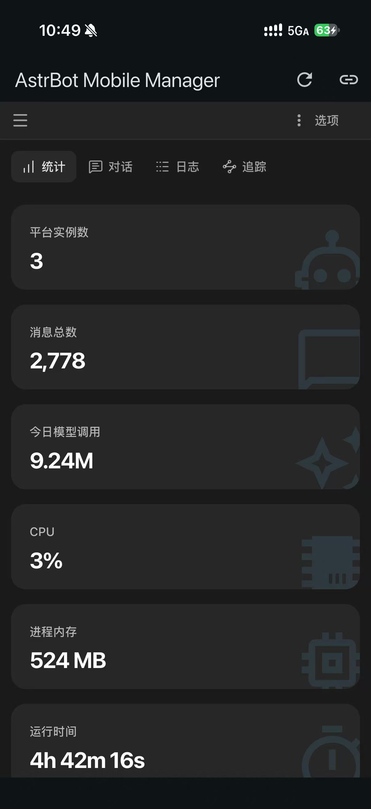
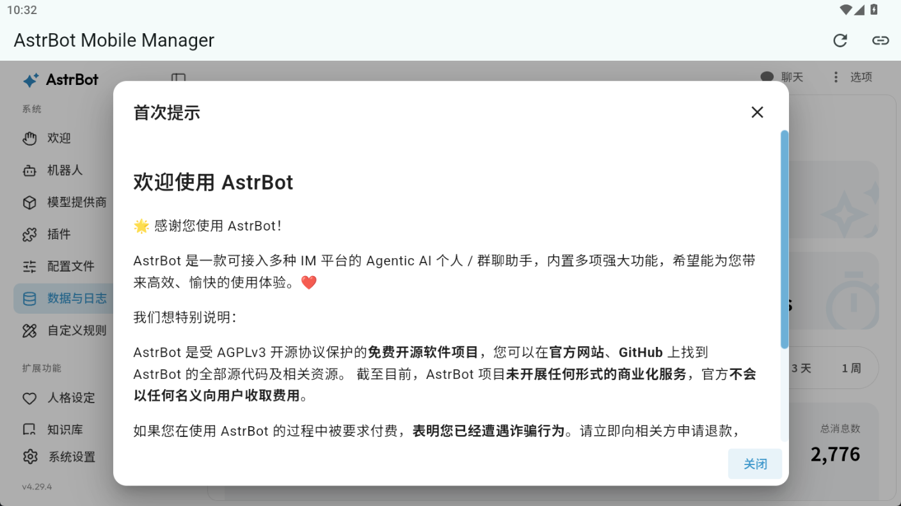

# AstrBot Mobile Manager

[English](README.md) · v0.1.0 · AGPL-3.0-or-later

AstrBot Mobile Manager 是一个独立的非官方社区客户端，用于在 Android 和 iOS 上管理已部署的 AstrBot。App 直接打开服务器上的 AstrBot WebUI，继续使用 AstrBot 的登录、权限验证和已配置的双因素认证。

手机直接连接服务器已有的 SSH 服务。AstrBot 管理端口无需对公网开放，也无需配置域名、HTTPS 反向代理、VPN 或额外部署服务。

## 界面示例

### 竖屏统计页



### 横屏首次提示



## 服务器要求

- 手机必须能够访问服务器的 SSH 端口。SSH 账户必须允许向 WebUI 目标进行本地 TCP 转发。OpenSSH 用户可检查适用于该账户的 `AllowTcpForwarding` 和 `PermitOpen` 设置。
- SSH 服务器必须能访问 AstrBot 的 HTTP WebUI。默认目标是 **SSH 服务器视角**的 `127.0.0.1:6185`。Docker 部署可以使用 `127.0.0.1:6185:6185` 将 WebUI 端口仅映射到宿主机回环地址。容器内的进程需要监听映射可以访问的接口。
- 请通过 AstrBot 的正常初始化流程设置强密码，按需要启用 TOTP，并继续使用 AstrBot 自己的登录机制。

## 使用

1. 填写 SSH 主机、端口和用户名。选择密码认证，或导入 OpenSSH 或受支持的 PEM 私钥并填写口令。
2. 填写 WebUI 的目标地址和端口，点击 **保存并连接**。
3. 将 App 显示的 SHA256 主机指纹与服务器控制台或管理员提供的指纹核对。在 SSH 服务器上运行 `ssh-keygen -lf /etc/ssh/ssh_host_ed25519_key.pub -E sha256` 可以查看 Ed25519 指纹。其他算法需选择相应的主机公钥文件。
4. 在 WebUI 中登录 AstrBot。工具栏可刷新页面，设置中可修改服务器、断开连接或切换浅色、深色与系统主题。初版支持一份连接配置。
5. 发现主机指纹变化时，先通过可信渠道确认新指纹。确认是服务器更换了密钥，再进入 **设置 → 重置主机指纹**，重新连接并确认。

## 隧道与会话

```text
WebView → 127.0.0.1:<手机本地端口> → SSH 本地端口转发 → AstrBot HTTP WebUI
```

首次连接由操作系统分配可用端口。App 仅监听 IPv4 回环地址，每个本地 TCP 连接使用独立的 SSH direct-tcpip 通道。HTTP、WebSocket、SSE 和文件请求使用同一条 SSH 连接，并保留 WebUI 原有的登录流程。

自动重连时保留本地监听端口和当前 WebView。手动断开或重启后也会优先复用之前的端口。如果端口被占用、更换了目标服务器或清除了 WebUI 数据，可能需要重新登录。App 回到前台时检查 SSH 会话，必要时恢复连接。系统挂起 App 时，正在进行的上传或流式请求可能中断。

手机与 SSH 服务器之间的通信经过 SSH 加密。若 WebUI 部署在另一台主机，SSH 服务器到该主机的最后一段遵循该网络的 HTTP 安全条件。WebUI 的主题与语言在 AstrBot 中选择。

## 安装

- **Android 7.0 及以上（API 24）** — ARM64 手机本地测试可安装 `astrbot-mobile-manager-0.1.0-arm64.apk`（约 19 MiB）。**Android test APK** 工作流目前生成体积较大的通用调试包 `app-debug.apk`。两种包都使用调试签名，覆盖安装需要签名一致且版本号符合 Android 的更新规则。
- **iOS 15 及以上** — **iOS unsigned IPA** 工作流配置用于生成 `astrbot-mobile-unsigned.ipa`，可用 SideStore 或 Sideloadly 等工具签名。也可以打开 Xcode 工程配置签名后为设备构建。更改签名团队或 Bundle ID 可能影响已有 Keychain 数据的读取。

通过 GitHub 构建时，先确认工作流文件已进入仓库默认分支。打开 **Actions** 并选择对应工作流，在 **Run workflow** 中选定分支，运行完成后从 **Artifacts** 下载产物。

## 开发与构建

使用 **Flutter 3.50.1**（Dart 3.14）。Android 需要 JDK 21、Android SDK 平台 35 和 36、Build Tools 36.0.0、NDK 28.2.13676358 和 CMake 3.22.1。iOS 构建需要 macOS 和 Xcode。GitHub Actions 使用同一 Flutter 版本及锁定依赖。

```sh
flutter pub get --enforce-lockfile
flutter analyze
flutter test
flutter build apk --release --split-per-abi
```

Android APK 输出在 `build/app/outputs/flutter-apk/`。ARM64 手机使用 `app-arm64-v8a-release.apk`。iOS 构建在 macOS 上执行，Flutter 通过 Swift Package Manager 解析插件依赖。

```sh
flutter precache --ios
flutter build ios --release --no-codesign
python3 tool/package_ipa.py build/ios/iphoneos/Runner.app build/astrbot-mobile-unsigned.ipa
```

### 验证状态

Windows 上的 `flutter analyze` 和启用 SSH 测试服务后的 10 项本地测试均已通过。Android 模拟器通过了安全存储与测试页面会话保留两项验证，ARM64 Release APK 已验签。macOS 已成功构建 iOS Release，未签名 IPA 已校验为适用于 iOS 15 及以上的 ARM64 真机包。竖屏示例展示了实际 AstrBot 实例的统计页。登录步骤、TOTP 和文件导入导出仍待逐项验证。

默认 `flutter test` 跳过 SSH 集成测试。如需运行，先安装 Paramiko 5.1.0，并将环境变量 `ASTRBOT_SSH_TEST` 设为 `1`。连接设备或模拟器后，可用 `flutter test integration_test/webui_test.dart -d <设备 ID>` 运行移动端集成测试。

## 初版范围与上游

初版支持一个 AstrBot 实例的 HTTP WebUI。内嵌浏览器的顶层页面限于当前隧道地址。Android 一次可导出一个最多 256 MiB 的 WebUI 文件。个别插件页面可能依赖独立浏览器中的额外能力。

上游项目和文档包括 [AstrBot](https://github.com/AstrBotDevs/AstrBot)、[AstrBot Desktop](https://github.com/AstrBotDevs/AstrBot-desktop)、[AstrBot 官方网站](https://astrbot.app/)、[官方最终用户许可协议](https://github.com/AstrBotDevs/AstrBot/blob/master/EULA.md)与[项目声明](https://github.com/AstrBotDevs/AstrBot/blob/master/FIRST_NOTICE.md)。本项目为独立开发的社区客户端。开发时核对的上游版本为 [AstrBot f37e158](https://github.com/AstrBotDevs/AstrBot/tree/f37e158dc1a5b5f2d90515a937e1c1aabde6b4ce)与 [AstrBot Desktop 32b0e69](https://github.com/AstrBotDevs/AstrBot-desktop/tree/32b0e693ca865276f8162bab9fdf7ecb08d11fa9)。

## 开源许可

项目采用 [AGPL-3.0-or-later](LICENSE) 开源许可。分发二进制时请同时提供完整的对应源代码、构建流程、[许可证](LICENSE)和[第三方声明](THIRD_PARTY_NOTICES.md)。另见[隐私说明](PRIVACY.md)。
